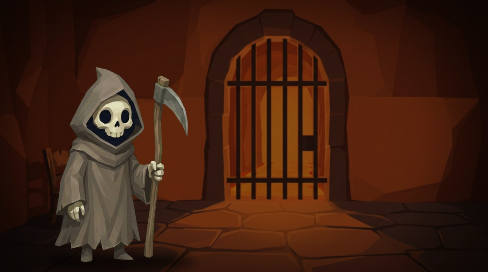

# Polar Game Engine

Un motor y editor para hacer aventuras gráficas de apuntar y hacer clic (*point & click*) al estilo de Monkey Island, Day of the Tentacle o Broken Sword, sin escribir código. Lo diseñas todo en el navegador y lo exportas como página web, app de escritorio (Windows, Mac, Linux) o app de Android.

*A no-code point & click adventure game engine and editor. The interface is in Spanish.*



## Qué trae

- **Editor de escenas.** Fondos, zonas interactivas dibujadas como polígonos, áreas por donde camina el personaje, profundidad (el personaje se achica al alejarse), objetos que lo tapan en primer plano y puertas entre escenas.
- **Diálogos con ramas.** Opciones, condiciones (variables, objetos del inventario), efectos (dar objetos, cambiar de escena, terminar el juego, mostrar una cinemática) y vista previa.
- **Inventario y acertijos.** Objetos que se recogen, se usan en el escenario o se combinan.
- **Objetivos.** Misiones con pasos que se cumplen solos según lo que hace el jugador.
- **Personaje animado.** Reposo y ciclo de caminar por dirección, accesorios que se pone según una condición (un bigote, un sombrero) y una herramienta para armar el ciclo de caminar.
- **Título, cinemáticas y créditos.** Pantalla de título con «Nueva partida» y «Continuar», diapositivas sobre negro (imagen con texto o video) para la intro, los finales y los momentos especiales, y créditos al final.
- **Música y sonido.** Música por escena, ambiente y efectos.
- **Verificar el juego.** Recorre todas las partidas posibles y avisa si hay finales a los que no se puede llegar o callejones sin salida.
- **Jugar y exportar.** Prueba el juego dentro del editor, con partida guardada, y expórtalo como página web (un solo HTML), app de Windows, Mac o Linux, o app de Android.
- **Generar con IA (opcional).** Fondos, objetos y personajes con la API de OpenAI, si pones tu propia llave.

## Empezar

Necesitas [Node.js](https://nodejs.org) 20.9 o más nuevo.

```bash
git clone https://github.com/zeroazulagencia/polar-game-engine.git
cd polar-game-engine
npm install
npm run dev
```

Abre <http://localhost:4600>. Se abre la demo: la primera escena de *La Muerte ha muerto*, donde RIPMAN, la Muerte despedida y reemplazada por una IA, tiene que escapar de su celda. Entra a **Jugar** para probarla y a **Editor de escenas**, **Diálogos** o **Título y cinemáticas** para ver cómo está hecha.

Para empezar tu propio juego: menú del proyecto (arriba a la izquierda) → **Nuevo proyecto**.

## Dónde se guarda tu juego

Cada proyecto es una carpeta dentro de `data/projects/<id>/`: un `project.json` y una carpeta `assets/` con las imágenes, sonidos y videos como archivos normales. Así tu juego se puede versionar con git como cualquier código. Los cambios sin guardar quedan en `draft.json`, que no se sube a git.

Para pasarle un proyecto a otra persona: menú del proyecto → **Exportar proyecto**; del otro lado se abre con **Proyectos → Importar**.

## Publicar tu juego

En el editor: menú del proyecto → **Exportar juego**, y eliges dónde se va a jugar.

| Opción | Qué obtienes | Notas |
| --- | --- | --- |
| **Página web (HTML)** | Un único `.html` con todo adentro (arte, sonido y el reproductor) | Súbelo a cualquier hosting estático (GitHub Pages, Netlify, tu servidor) o compártelo tal cual |
| **Windows (.exe)** | `dist/<juego>-windows.zip`: una carpeta con el `.exe` | Se puede armar desde Mac, sin Windows |
| **Mac (.app)** | `dist/<juego>-mac.zip`: la app, para Mac con Apple Silicon e Intel | Ármala desde un Mac |
| **Linux** | `dist/<juego>-linux.zip`: una carpeta con el ejecutable | |
| **Android** | `dist/<juego>-android-debug.apk`, o un proyecto de Android Studio | El APK sale solo si tienes [Android Studio](https://developer.android.com/studio) instalado; si no, queda el proyecto listo en `dist/<juego>-android/android` para abrirlo con él |

Las versiones de escritorio usan [Electron](https://www.electronjs.org) y la de Android, [Capacitor](https://capacitorjs.com): el juego es el mismo HTML dentro de una ventana propia, con la partida guardada en el equipo del jugador. La primera vez que exportas para cada sistema se descarga lo necesario (unos 100 MB por sistema) y tarda unos minutos; después es rápido. Cada versión de escritorio pesa entre 100 y 250 MB porque lleva su propio navegador adentro. En la ventana del juego, F11 o Alt+Enter cambian a pantalla completa.

**Firmas.** Lo que sale del motor no está firmado: sirve para probar y para compartir, pero el sistema avisa la primera vez.

- En **Mac**: clic derecho sobre la app → **Abrir** → **Abrir**. Para distribuirla sin aviso hace falta una cuenta de [Apple Developer](https://developer.apple.com/programs/) y firmar y notarizar la app.
- En **Windows**: en el aviso de SmartScreen, **Más información** → **Ejecutar de todas formas**. Para quitar el aviso hace falta un certificado de firma de código.
- En **Android**: el APK de prueba se instala activando «Instalar apps desconocidas». Para Google Play hay que generar un paquete firmado desde Android Studio (Build → Generate Signed App Bundle).

iPhone y iPad todavía no: necesitan Xcode y una cuenta de Apple Developer.

También se puede empaquetar desde la terminal, con un HTML ya exportado:

```bash
npm run package -- mi-juego.html --target windows   # o mac, linux, android, all
npm run package -- mi-juego.html --target android --name "Mi juego" --id com.miestudio.mijuego
```

`--id` es el identificador de la app (el de Google Play o de Apple); si no lo pones, se arma uno a partir del nombre.

## Tu juego en su propio repositorio

Para un juego en serio conviene separar el juego del motor: tu repo guarda solo tu proyecto y usa Polar como submódulo, así actualizas el motor sin mezclarlo con tu contenido.

```bash
git submodule add https://github.com/zeroazulagencia/polar-game-engine.git engine
npm --prefix engine install
POLAR_DATA_DIR="$PWD/data" POLAR_DIST_DIR="$PWD/dist" npm --prefix engine run dev
```

| Variable | Qué hace | Si no la pones |
| --- | --- | --- |
| `POLAR_DATA_DIR` | Carpeta con tus proyectos (`projects/`) y tu lista de pendientes | `data/` dentro del motor |
| `POLAR_DIST_DIR` | Carpeta donde quedan las apps exportadas | `dist/` dentro del motor |

Para actualizar el motor: `git -C engine pull` y `npm --prefix engine install`.

## Generar arte con IA (opcional)

El motor funciona completo sin IA. Si quieres generar imágenes desde el editor:

1. Copia `.env.example` como `.env.local`.
2. Pon tu llave de OpenAI en `OPENAI_API_KEY`.
3. Reinicia `npm run dev`.

La llave se queda en tu computador: el navegador nunca la ve, porque las llamadas pasan por el propio servidor de la app (`app/api/openai`). `.env.local` está en `.gitignore`, así que no se sube a git. Nunca la pongas en otro archivo del proyecto.

## Seguridad: es una herramienta local

El editor está pensado para correr en tu propia máquina con `npm run dev`. Sus rutas internas (`/api/storage` escribe en `data/`, `/api/openai` usa tu llave, `/api/package` arma apps en `dist/`) **no tienen usuarios ni contraseñas**. No publiques el editor en internet tal cual: cualquiera podría modificar tus proyectos o gastar tu crédito de OpenAI. Lo que se publica es el juego exportado, que es solo un HTML.

## Paquetes de contenido

Además de editar a mano, puedes generar contenido con scripts y cargarlo desde **Proyectos → Importar**: un JSON con `"schema": "pixelquest-content-v1"` y listas de `scenes`, `dialogs`, `items`, `quests`, `assets`, `sounds` y `cinematics`. Lo que tenga el mismo `id` se actualiza y lo demás se agrega; nada se borra. Los tipos están en [`lib/game-types.ts`](lib/game-types.ts) y la mezcla en [`lib/content-pack.ts`](lib/content-pack.ts).

## Estructura

| Carpeta | Qué hay |
| --- | --- |
| `app/` | Páginas del editor (Next.js) y las dos rutas internas de la API |
| `components/` | Interfaz del editor; `components/editor/play-mode.tsx` es el motor del juego |
| `lib/` | Tipos del proyecto, guardado en disco, exportación, verificador del juego, audio |
| `player/` | Punto de entrada del reproductor que va dentro del HTML exportado |
| `scripts/package-game.mjs` | Empaqueta el HTML exportado para Windows, Mac, Linux y Android |
| `data/projects/` | Tus proyectos (y la demo) |

Comandos: `npm run dev` (editor en el puerto 4600), `npm run build` (compilación de producción) y `npm run package` (empaquetar un juego exportado, ver arriba).

## Licencia

El código está bajo la licencia [MIT](LICENSE): úsalo, modifícalo y publica tus juegos, también comerciales.

El arte, la música y los textos de la demo (*La Muerte ha muerto*, en `data/projects/demo-la-muerte-ha-muerto/` y `docs/`) **no** son parte de esa licencia: son de Zero Azul y solo se incluyen para que pruebes el motor. Ver [ASSETS-LICENSE.md](ASSETS-LICENSE.md).
